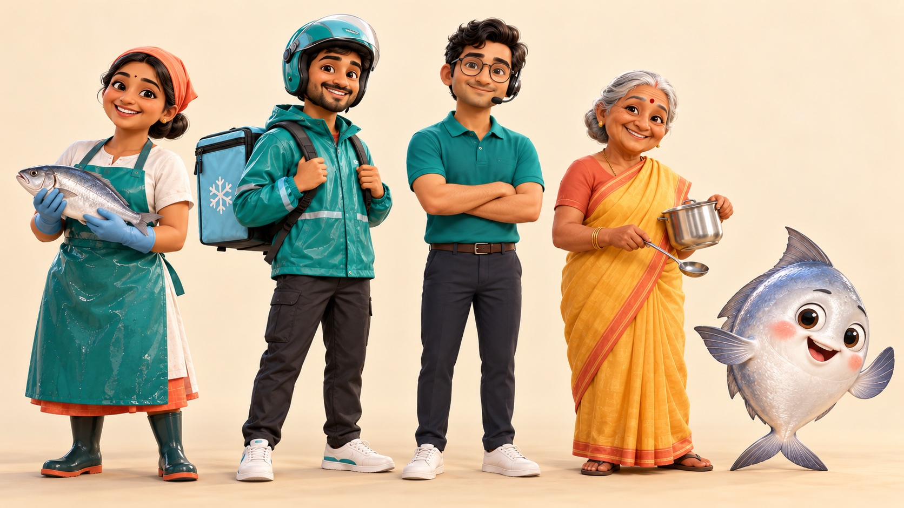

# Illustrations (D53)

Every picture in the website, the admin dashboard and the mobile app fills one **slot**. The slots, their alt text,
scenes and generation prompts live in `packages/illustrations/manifest.json` (`@fresh/illustrations`). Until the
owner's final image for a slot is imported, the apps show our own clay-look placeholder SVG for it.

Owner how-to (generate, import, optimize, validate): `packages/illustrations/README.md`.

## 1. Cast

The approved reference is [`characters/character-sheet.jpg`](characters/character-sheet.jpg) (see
[`characters/README.md`](characters/README.md)). Every image must match it: same faces, hair, clothes and colours.



| Key in manifest | Name | Role | Look |
|---|---|---|---|
| `FISHMONGER` | Padma | Fishmonger, our lead | Coral headscarf over a low bun, white kurta, glossy sea-teal apron, light-blue gloves, dark-green rubber boots, often holds a silver fish |
| `RIDER` | Ravi | Delivery rider | Sea-teal helmet with clear visor, teal rain jacket with reflective stripes, ice-blue insulated backpack with a white snowflake, dark cargo trousers, white sneakers, short beard |
| `SUPPORT_AGENT` | Anil | Support agent | Round thin glasses, wavy black hair, teal polo, slim black headset, navy trousers |
| `HOME_COOK` | Ammamma | Home cook | Silver bun, red bindi, mango-yellow saree with coral border, gold bangles, steel pot and ladle |
| `POMFRET` | Chanduva | Sidekick | Round silver pomfret, big glossy eyes, rosy cheeks, open happy smile, fins as hands; a character, never food |

The full descriptions copied into every prompt are the `characters` entries in the manifest.

## 2. Style rules

- **Style block** (the manifest's `stylePrompt`, in every prompt): highly detailed, realistic 3D animated-film style
  character render, soft subsurface skin, natural hair and fabric, expressive friendly faces, warm cinematic studio
  light, shallow depth of field, brand accents sea teal `#0B7D70` and coral `#F07A5A`, coastal Andhra Pradesh.
- **Every prompt ends** "No text, no letters, no numbers, no logos, no watermark. High resolution." Labels such as
  "Fresh today" are real text in the UI (`Sticker`), never inside an image.
- **Never name another studio or brand** in prompts or docs; never copy characters, colours, names or layouts from
  other apps (references are ideas only). `validate` refuses the two studio names we were warned about.
- **Backgrounds** (`background` in the manifest):

  | Value | Meaning | How components show it |
  |---|---|---|
  | `SCENE` | A full picture with its own scenery (harbour at sunrise, market, kitchen); usually JPEG | Cropped with `object-fit: cover` to the slot's shape inside a rounded frame (24–32 px) |
  | `SAND` | Subject on the warm sand backdrop | Shown whole (`contain`) on a sand or tinted panel |
  | `TRANSPARENT` | Cut-out subject; PNG or WebP with alpha | Shown whole (`contain`), may float gently in heroes |

  `import` sets `SCENE` or `TRANSPARENT` from the file itself (alpha or not) and rebuilds the prompt to match.
- **Shapes**: `1:1` (empty states, features, status) or `4:3` (onboarding, hero, delivery, admin login), 2% tolerance.
- **Files**: `assets/<slot_lower_snake>.jpg|png|webp`, at most 600 KB, longest side at least 1024 px. Placeholders:
  `assets/<slot_lower_snake>.svg`, under 6 KB, no text, generated from `src/placeholder-art.ts`.
- **Alt text**: one plain sentence describing the picture. Check it after importing a final; components make the
  picture decorative (`alt=""`) when nearby text already says the same thing.

## 3. Slots

32 slots (the handoff said 33; the list in `REQUIRED_SLOTS`, `src/manifest.ts`, is the source of truth). Status as of
this change: 2 FINAL, 30 PLACEHOLDER. The playground's **Illustrated** tab shows every slot with its alt text and
status.

| Slot | Shape | Cast | Website | Admin | Mobile |
|---|---|---|---|---|---|
| `ONBOARDING_FRESH` | 4:3 | Padma, Chanduva | Hero alternative, "why us" section | — | Onboarding page 1 |
| `ONBOARDING_CLEANED` | 4:3 | Padma | "Cleaned your way" section | — | Onboarding page 2 |
| `ONBOARDING_DELIVERY` | 4:3 | Ravi, Chanduva | Delivery promise section | — | Onboarding page 3 |
| `LOCATION_PICK` | 1:1 | Ravi | Pincode / location sheet | — | Location permission and pick |
| `NOT_SERVICEABLE` | 1:1 | Ravi, Chanduva | "We don't deliver here yet" + Notify me | — | Same |
| `EMPTY_CART` | 1:1 | Padma, Chanduva | Empty cart | — | Empty cart tab |
| `EMPTY_WISHLIST` | 1:1 | Ammamma | Empty wishlist | — | Same |
| `EMPTY_ORDERS` | 1:1 | Ravi | Account → Orders, none yet | — | Orders tab, none yet |
| `EMPTY_NOTIFICATIONS` | 1:1 | Chanduva | Notifications, none | — | Same |
| `EMPTY_ADDRESSES` | 1:1 | Ammamma | Account → Addresses, none | — | Same |
| `NO_SEARCH_RESULTS` | 1:1 | Padma, Chanduva | Search / filters with no result | — | Same |
| `OUT_OF_STOCK` | 1:1 | Padma | Product sold out / Notify me | — | Same |
| `LOGIN_OTP` | 1:1 | Ammamma | Login and OTP step | — | Login and OTP |
| `ORDER_PLACED` | 1:1 | Padma, Chanduva | Order success page | — | Order success |
| `ORDER_PACKING` | 1:1 | Padma | Tracking: preparing / packed | — | Same |
| `ORDER_ON_THE_WAY` | 4:3 | Ravi | Tracking: out for delivery | — | Same |
| `ORDER_DELIVERED` | 4:3 | Ravi, Ammamma | Tracking: delivered | — | Same |
| `ORDER_CANCELLED` | 1:1 | Chanduva | Tracking: cancelled | — | Same |
| `COMPLAINT_RECEIVED` | 1:1 | Anil | Complaint submitted | — | Same |
| `HELP_SUPPORT` | 1:1 | Anil | Help page (`HelpHero`) | — | Help screen |
| `ERROR_GENERIC` | 1:1 | Padma, Chanduva | Error page / failed load | Failed load (size `sm`) | Error screen |
| `OFFLINE` | 1:1 | Ravi | Offline notice | — | No connection |
| `NOT_FOUND` | 1:1 | Chanduva | 404 page | 404 page | Unknown deep link |
| `HOME_HERO` | 4:3 | Padma, Ravi, Chanduva | Home hero (`HeroBanner`) | — | Home banner |
| `FEATURE_HONEST_WEIGHT` | 1:1 | Padma | Home feature card | — | Home feature card |
| `FEATURE_CLEANED_YOUR_WAY` | 1:1 | Padma, Chanduva | Home feature card | — | Same |
| `FEATURE_COLD_CHAIN` | 1:1 | Chanduva, Ravi | Home feature card | — | Same |
| `FEATURE_SAME_DAY` | 1:1 | Ravi | Home feature card | — | Same |
| `ADMIN_LOGIN` | 4:3 | Padma | — | Staff login side panel | — |
| `ADMIN_EMPTY` | 1:1 | Chanduva | — | Empty lists (size `sm`) | — |
| `ADMIN_ALL_CAUGHT_UP` | 1:1 | Padma, Chanduva | — | Nothing left to pack / no exceptions | — |
| `ADMIN_NO_ACCESS` | 1:1 | Anil | — | 403 page | — |

Admin uses only `ADMIN_*`, `ERROR_GENERIC` and `NOT_FOUND`, at size `sm` (160 px) so dense screens stay dense.

## 4. Components (`@fresh/ui`)

| Component | Use | Key props |
|---|---|---|
| `Illustration` | One slot's picture with alt text and intrinsic size | `slot`, `size` (`xs` 96 · `sm` 160 · `md` 240 · `lg` 320 · `xl` 480 · `fill`), `priority`, `decorative`, `float`, `fit` (`auto` · `cover` · `contain`) |
| `IllustrationProvider` | Change where files load from | `baseUrl` (default `/illustrations`) |
| `EmptyState` | Empty lists and pages | `slot`, `illustrationSize`, `illustrationDecorative` (default true), `headingLevel` |
| `HeroBanner` | Home or onboarding hero; text never on the picture | `title`, `description`, `actions`, `slot` (default `HOME_HERO`), `stickers`, `reverse`, `headingLevel` |
| `FeatureCard` | Benefit card: big picture, chunky headline, one line. **No numbers** | `slot`, `title`, `description`, `tone` (`sand` · `teal` · `ice` · `coral`), `headingLevel` |
| `PolaroidCard` | Photo card with ink border, sand block shadow, stickers on corners | `slot`, `caption`, `stickers[{ label, tone, corner }]`, `tilt` (−2.5° on wide screens) |
| `Sticker` | Short label, Baloo 2 800, ink outline and offset shadow | `tone` (`coral` · `mango` · `teal` · `paper`), `size` (`sm` · `md`), `tilt` (`left` · `right` · `none`) |
| `HelpHero` | Help page header | `title`, `description`, `actions`, `slot` (default `HELP_SUPPORT`), `circleTone` (`mango` · `teal` · `coral` · `sand`) |
| `ReceiptCard` | Order summary as a paper receipt with scalloped edge | `title`, `meta`, `sections` (lines of `{ label, value, description, tone }`), `total`, `note`, `footer` |

`ReceiptCard` shows values exactly as passed: format server amounts with `formatRupees`; it never adds lines up.
Helpers: `resolveIllustration(slot, baseUrl, size)` and `isSceneIllustration(slot)`.

Motion: `float` and the polaroid tilt run only with `motion-safe`; nothing moves under reduced motion. Scene
images never float.

### In an app

```json
{ "scripts": { "dev": "fresh-illustrations-copy public/illustrations && vite", "build": "fresh-illustrations-copy public/illustrations && vite build" } }
```

Import `@fresh/ui/fonts.css` once (self-hosted Baloo 2 and Inter), or load the same fonts with `next/font` and set
`--fo-font-display`. Add `public/illustrations/` to `.gitignore`.

Mobile: `pnpm --filter @fresh/illustrations sync-mobile` copies the files into `apps/mobile/assets/illustrations/` and
writes `lib/core/illustrations/illustration_slots.g.dart` (`IllustrationSlot`, `IllustrationAsset` with `asset`,
`placeholder`, `alt`, `aspectRatio`, `transparent`, `scene`, `isFinal`). Show `scene` assets with `BoxFit.cover` in a
`ClipRRect`.

## 5. Swapping in a final image

1. The owner saves the image as `docs/design/characters/generated/<slot_lower_snake>.jpg` (or `.png` when
   transparent) and adds it to the table in `characters/README.md`.
2. `pnpm --filter @fresh/illustrations run import` copies it into the package and marks the slot FINAL with its size
   and background. (`run` is required: `pnpm import` is a different, built-in pnpm command.)
3. Check the slot's `alt` matches the picture.
4. If `import` lists a problem (too heavy, wrong shape), run `pnpm --filter @fresh/illustrations optimize`.
5. `pnpm --filter @fresh/illustrations validate`, then `pnpm build`; mobile: `sync-mobile`.
6. Commit the image and `manifest.json` together.
